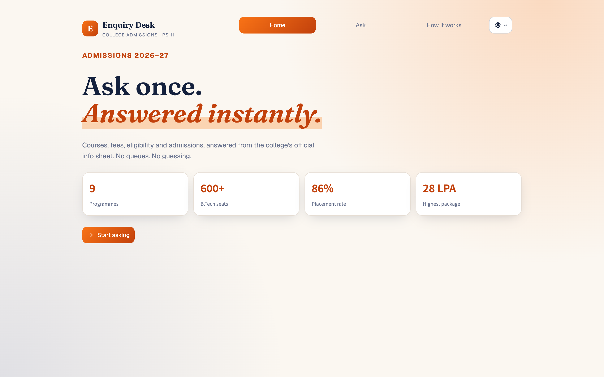
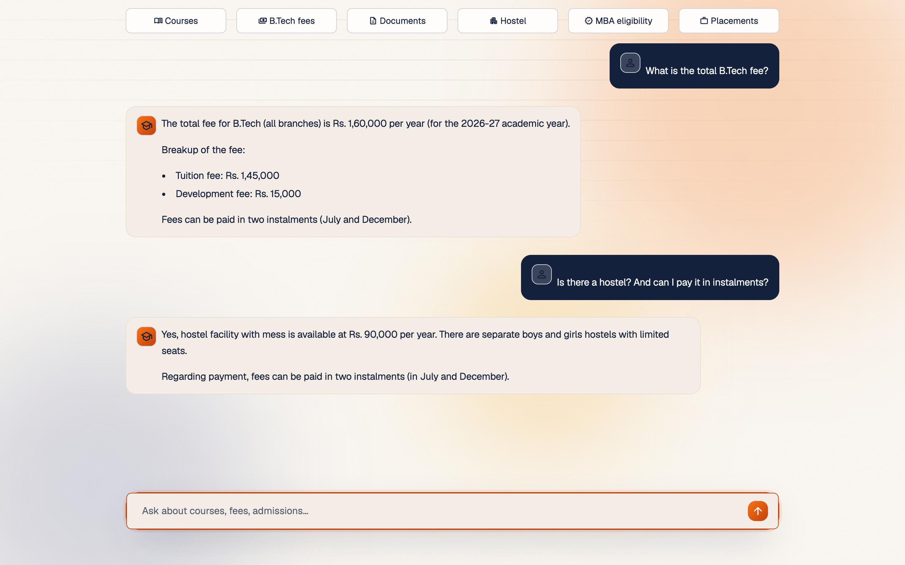

# College Enquiry Chatbot (LLM Mini Project, PS 11)

## Problem statement
Admission offices answer the same questions again and again. This chatbot answers questions about
courses, fees, eligibility and admissions using **only** the college's info sheet (`college_info.txt`).

## How it works
1. The college info is stored in `college_info.txt`.
2. The info is put into the **system prompt** with the rule "answer only from this info". If the answer isn't there, the bot gives a fixed fallback reply.
3. The Streamlit chat UI uses `st.chat_input`, and the chat history is kept in `st.session_state`.
4. The look (colours, fonts, buttons, chat bubbles) comes from `style.css` and `.streamlit/config.toml`.
5. The LLM is **Gemini 3.5 Flash** (free API key). 3.5 Flash Lite and 2.5 Flash can be picked in Settings (gear icon, top right).

## How to run
```bash
pip install -r requirements.txt
cp .env.example .env        # then paste your Gemini API key into .env
streamlit run app.py
```

To use the bot for a different college, edit `college_info.txt`. You don't need to change any code.

## Deploy on Render (free)
1. Sign in at render.com with GitHub and allow it to access this repository.
2. Click **New → Blueprint** and pick this repository. Render reads `render.yaml`.
3. When asked for `GEMINI_API_KEY`, paste your Gemini key (it stays in Render, not in the code).
4. Click **Apply**. After the build (about 3–5 minutes) the app is live at a `*.onrender.com` link.

The free plan sleeps after 15 minutes without visitors; the first visit after that takes about a minute to wake it up.

## Screenshots



## Tech stack
Python · Streamlit · Google Gemini API (google-genai) · python-dotenv
