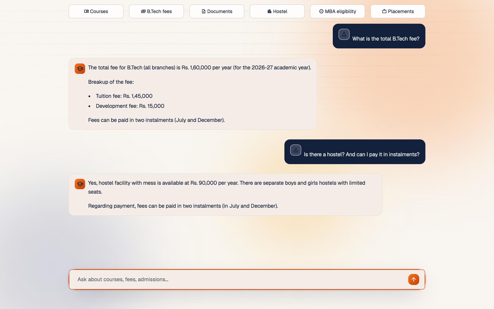

# College Enquiry Chatbot: Procedure Report

**PS No:** 11 &nbsp;|&nbsp; **Name:** Piyush Bavane &nbsp;|&nbsp; **Roll No:** 11 (ADT23SOCB0726) &nbsp;|&nbsp; **Class:** BTech CSE
**GitHub:** https://github.com/PiyushB046/llm-ps11-ADT23SOCB0726

## 1. Problem statement
Every admission season, the college office answers the same questions again and again: courses, fees, eligibility and how to apply. I built a chatbot that answers them straight from the college's information sheet, so students and parents get answers any time and the office staff save time.

## 2. Tools & model
**Language:** Python 3 · **LLM:** Google Gemini 3.5 Flash through the free Gemini API (`google-genai` library); Llama 3.2 through Ollama can be used offline · **UI:** Streamlit (`st.chat_input`, `st.chat_message`, `st.session_state`, `st.popover`) with my own CSS · **Other:** python-dotenv, requests, Git and GitHub.

## 3. Procedure
1. I made a project folder and a Python virtual environment, and installed streamlit, google-genai, python-dotenv and requests.
2. I created a free API key in Google AI Studio and kept it in a `.env` file. I added `.env` to `.gitignore` so the key never goes to GitHub.
3. I wrote `college_info.txt`, a sample info sheet for a demo college with courses, seats, fees, eligibility, admission steps, documents, dates, placements and facilities.
4. I wrote the system prompt. It contains the whole info sheet and a few rules: answer only from this sheet, never make up numbers, give a fixed reply with the office contact when the answer is missing, and keep answers short.
5. I wrote `app.py`. For every question it reads the info file, builds the prompt, sends it to Gemini along with the last 10 chat messages (temperature 0.2), and shows the reply.
6. I built three pages (Home, Ask, How it works) with a navigation bar at the top. The Ask page has six quick-question buttons and the chat. The history is saved in `st.session_state.messages`, so follow-up questions work. A gear button opens settings (model choice, "Clear chat"). The styling is in `style.css`, loaded with `st.markdown(..., unsafe_allow_html=True)`.
7. I tested the app with the six questions in the table below and took screenshots.
8. I wrote the README and requirements.txt and pushed the project to GitHub.

## 4. Prompt used
```
You are the admission enquiry assistant for a college.
Answer the user's question using ONLY the college information given below.
Rules:
1. If the answer is not in the information, reply exactly: "Sorry, I don't have that information.
   Please contact the admission office." and add the office phone/email.
2. Never guess or invent fees, dates, seats or eligibility numbers.
3. Keep answers short (2-6 lines). Use bullet points for lists.
4. Mention amounts in Rupees exactly as written in the information.
5. Be polite. If the user greets you, greet back and say what you can help with.
COLLEGE INFORMATION: """ <contents of college_info.txt> """
```
**Improvement I made:** just saying "answer from this info" does not tell the model what to do when the answer is not in the sheet, and that is exactly when a model tends to guess. So I added rule 1 (a fixed reply with the office contact) and rule 2 (no made-up numbers), and set the temperature low (0.2) so answers stay consistent. Test 6 below shows this working.

## 5. Results
| # | Question I asked | What the bot did |
|---|---|---|
| 1 | What B.Tech branches do you offer? | Listed all 6 branches ✔ |
| 2 | What is the total fee for B.Tech? | Rs. 1,60,000 (1,45,000 tuition + 15,000 development) ✔ |
| 3 | Which documents are needed for admission? | Listed all 9 documents ✔ |
| 4 | Is there a hostel and what does it cost? | Rs. 90,000 per year, mess included ✔ |
| 5 | And can I pay that in instalments? (follow-up) | Remembered the hostel question: two instalments, July and December ✔ |
| 6 | What was last year's cut-off percentile? (not in sheet) | Said it doesn't have that information and gave the office phone and email ✔ |



## 6. Challenges
- **Error 400 "Developer instruction is not enabled for api version v1":** the system prompt only works on the `v1beta` version of the API, so I create the client with `HttpOptions(api_version="v1beta")`.
- **Chat history disappearing after every message:** Streamlit runs the whole script again on each click, so I stored the messages in `st.session_state`.
- **Error 429 RESOURCE_EXHAUSTED:** while testing I used up the free limit (first per minute, then 20 requests a day on gemini-2.5-flash). I switched to gemini-3.5-flash, added a model picker in settings, and made the app show a short friendly message when the limit is reached.
- **Different role names:** Gemini calls the bot's messages `model` instead of `assistant`, so I convert the roles before each call.

## 7. Conclusion
The chatbot answers course, fee and admission questions correctly, handles follow-ups, and admits when it does not know. The sheet has sample data, but any college's real details can be pasted in without changing code. One limitation is that the whole sheet is sent with every question, which will not work well for a long brochure. **Future improvement:** use RAG (FAISS or ChromaDB) to search only the relevant part of a brochure PDF, and put the app online with Streamlit Community Cloud.
